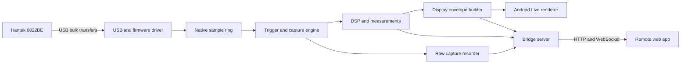

# Oh Scope Android App Plan

**Status:** Initial product and engineering plan  
**Primary hardware:** Hantek 6022BE, with 6022BL compatibility where practical  
**Primary host:** Modern USB-C Android phone or tablet  
**Operating modes:** Live and Wi-Fi Bridge

## Vision

Build a modern, open-source Android oscilloscope application for the Hantek
6022BE. The Android device connects directly to the scope over USB, owns the
complete acquisition and signal-processing pipeline, and can operate in either
of two modes:

1. **Live mode** presents a complete touch-first oscilloscope interface on the
   Android device.
2. **Wi-Fi Bridge mode** continues acquisition and processing on Android, then
   serves a responsive remote scope interface to a browser, phone, tablet, or
   computer over the local network.

Both modes use the same device driver, trigger engine, calibration, measurement
code, capture storage, and rendering data. Switching modes changes where the
interface is presented; it does not create a second acquisition implementation.

The first release should make the inexpensive 6022BE feel like a current
instrument: fast startup, stable triggering, fluid touch controls, reliable
reconnection, useful measurements, clear errors, and an efficient network mode.

## Product decisions

- The app is open source. GPL-3.0-or-later is the leading license choice because
  the most useful upstream projects are GPLv3, subject to a source-by-source
  license audit before code is imported.
- Android is the USB host and processing engine. Root access is not required.
- The initial hardware target is the 6022BE. Device abstractions should permit
  later models, but early releases will not trade 6022BE reliability for broad,
  shallow compatibility.
- Live and Bridge are explicit top-level modes. The USB connection should remain
  open while switching whenever Android and the attached hub allow it.
- The first remote client is an installable web app served by the Android phone.
  This immediately supports iOS, iPadOS, Android, macOS, Windows, and Linux
  without requiring direct USB access on those platforms.
- High-rate raw samples remain on the Android host during normal bridge use.
  The bridge sends display-ready envelopes, measurements, status, and control
  messages. Triggered raw captures can be downloaded separately.
- The app works offline. It requires no account, cloud service, analytics
  service, or internet connection.
- Measurement settings and exported data always include units, probe attenuation,
  sample rate, channel configuration, calibration, trigger settings, and time.

## User experience

### Device connection

The expected physical setup is:

```text
Hantek 6022BE
      | USB-B data/power cable
      v
Powered USB-C OTG/PD hub
      | USB-C host connection
      v
Android phone or tablet
      |
      +-- charger or power bank through hub PD input
```

The app detects both the Hantek bootloader identity and its post-firmware runtime
identity. On first connection, Android may show two USB permission prompts because
the FX2 processor disconnects and re-enumerates after firmware upload. The app
must explain this sequence instead of presenting the second prompt as a failure.

Simultaneous USB host mode and phone charging depends on the Android device and
hub. The app should report charging state, USB connection state, and power-saving
conditions, but it cannot make an incompatible phone/hub combination support PD
pass-through.

### Live mode

Live mode is the full local instrument interface. The default layout is landscape
and touch-first, while remaining usable in portrait and on large tablets.

The primary screen includes:

- a two-channel waveform view with a conventional oscilloscope graticule;
- large run/stop and single-capture controls;
- channel enable, volts/div, position, probe ratio, and software AC/DC coupling;
- time/div, sample rate, capture depth, interpolation, and persistence;
- trigger source, level, edge, mode, hysteresis, holdoff, and pre-trigger position;
- automatic measurements, movable cursors, and an FFT/spectrum view;
- clear clipping, dropped-transfer, USB, charging, thermal, and calibration status;
- pinch zoom, pan, draggable channel zero markers, and draggable trigger level;
- save, share, and export actions that preserve acquisition metadata.

The waveform should remain responsive while controls are manipulated. Control
changes should apply at a safe acquisition boundary and visibly confirm the
effective setting reported by the driver.

### Wi-Fi Bridge mode

Bridge mode replaces the local scope UI with a low-power status screen showing:

- acquisition state and channel/sample-rate summary;
- local URL, QR code, and short pairing code;
- connected clients and the current controller;
- Wi-Fi quality, transmitted bitrate, phone battery, charging, and temperature;
- controls to stop acquisition, revoke clients, or return to Live mode.

The Android foreground service continues acquiring with the display dimmed or
off. It holds a Wi-Fi lock and a narrowly scoped wake lock only while bridge
acquisition is active.

The first paired client becomes the controller. Additional clients are observers
until control is explicitly transferred. A disconnected controller releases its
lease after a short timeout so an abandoned browser cannot lock the instrument.

The remote interface mirrors the important Live-mode controls and remains usable
as an installed progressive web app. It should recover cleanly from screen locks,
Wi-Fi roaming, browser suspension, and short network interruptions.

## Hardware facts that shape the design

The 6022BE is a streaming USB instrument built around dual 8-bit ADC channels and
a Cypress EZ-USB FX2LP controller. It has no deep acquisition memory and no useful
hardware trigger engine. The host must continuously receive samples, retain a
rolling history, find trigger events, and construct stable display frames.

The FX2 firmware is uploaded to RAM at each power-up. Firmware upload causes USB
re-enumeration, so connection handling is a state machine rather than a single
`open()` operation.

The product advertises 48 MS/s, but stable, useful rates depend on channel count,
USB scheduling, firmware, phone, and hub. The initial performance target is to
match the rates used successfully by OpenHantek6022: up to 30 MS/s in single-channel
operation and up to 15 MS/s per enabled channel in dual-channel operation. These
remain validation targets until measured on the actual Hantek and Android hardware.

The scope is USB-powered and its BNC grounds are common with USB ground. A powered
hub improves the power budget but does not provide measurement isolation.

## Architecture



### Android application layer

Kotlin and Jetpack Compose handle application state, permissions, lifecycle,
settings, storage, mode switching, and the touch interface. The acquisition runs
in a foreground service so it can survive activity recreation and continue in
Bridge mode with the screen off.

Compose should own controls and ordinary screens. The high-rate waveform surface
should use a dedicated `SurfaceView` with an OpenGL ES 3 renderer so redraws do
not rebuild the Compose tree or allocate objects per frame.

### Native scope core

A C++20 Android NDK library provides:

- firmware loading and the Hantek control protocol;
- asynchronous USB transfer scheduling;
- a bounded, preallocated sample ring;
- channel demultiplexing and calibrated sample conversion;
- trigger detection and capture assembly;
- min/max envelope generation and optional interpolation;
- measurements, filters, FFT input preparation, and file streaming;
- deterministic APIs that can run against saved fixtures without hardware.

The JNI boundary stays narrow. Kotlin sends immutable configuration snapshots and
receives compact status, measurement, and display-frame objects. Raw streaming
buffers should remain native unless the user explicitly exports a capture.

Android's `UsbManager` owns device discovery and user permission. The first
prototype should compare two transfer implementations:

1. asynchronous Android `UsbRequest` objects backed by pooled direct buffers;
2. libusb using `libusb_wrap_sys_device()` around Android's permitted file
   descriptor.

The implementation with the lowest sustained drop rate and cleanest reconnect
behavior becomes the production backend. This decision must be based on a
hardware benchmark, not assumed from desktop behavior.

### Acquisition pipeline

The hot path must avoid per-transfer and per-sample allocation:

```text
USB request pool
  -> lock-free or low-contention native ring
  -> trigger scan over integer samples
  -> bounded capture window
  -> calibrated measurements
  -> min/max value for each output pixel column
  -> local renderer and/or bridge frame
```

The ring initially reserves 64-128 MiB, adjusted to the device's RAM and selected
capture depth. Backpressure never silently corrupts time. If the processor cannot
keep up, the app records a discontinuity, increments a dropped-sample counter, and
marks affected frames and exports.

### Triggering

Version 1 needs a reliable software trigger because it determines whether the
instrument feels usable:

- rising and falling edge;
- channel 1 or channel 2 source;
- Auto, Normal, Single, and Roll modes;
- adjustable level, hysteresis, and holdoff;
- configurable pre-trigger position;
- noise filtering suitable for low-frequency and ordinary signals;
- stable behavior across capture-depth and timebase changes.

Triggering operates on raw integer samples with calibrated thresholds. Display
interpolation must not influence trigger decisions.

### Signal processing and measurements

The initial measurement set is minimum, maximum, peak-to-peak, mean/DC, RMS,
frequency, period, duty cycle, and edge count. Measurements carry a validity flag
and confidence or reason when the capture is insufficient, clipped, discontinuous,
or lacks enough cycles.

Display downsampling preserves extrema with min/max buckets. Averaging and
oversampling are explicit acquisition/display options; they must not masquerade
as increased analog bandwidth. FFT processing runs on a bounded copied window so
it cannot block USB completion.

Calibration starts with per-channel, per-gain offset and scale corrections. The
app stores calibration separately from raw captures and records the applied
calibration version in every saved capture.

## Bridge protocol

The phone runs a small embedded HTTP and WebSocket server bound only to the
selected local interface. It serves the remote web application from packaged
assets, so the client requires no internet connection.

Version 1 uses:

- HTTP for the web application, capabilities, capture listing, and downloads;
- WebSocket text messages for infrequent commands and state changes;
- versioned WebSocket binary messages for waveform envelopes and measurements;
- monotonically increasing acquisition, configuration, and frame sequence IDs;
- explicit timestamps and discontinuity flags.

At 1,280 horizontal pixels, two channels, one signed 16-bit minimum and maximum
per pixel, and 30 frames/s, waveform payload is about 2.5 Mbit/s before framing.
That is practical on ordinary 5 GHz Wi-Fi and far smaller than continuous raw USB
traffic. Frame rate and horizontal resolution adapt to measured network quality.

Continuous raw sample streaming is outside version 1. A client can request a
bounded triggered capture, after which the phone makes that capture available as
a download. This preserves full-fidelity analysis without making network jitter
part of acquisition correctness.

### Pairing and local security

- Each Bridge session creates a random secret displayed as a QR code and short
  pairing code.
- Tokens expire when Bridge mode stops and can be revoked from the phone.
- State-changing requests require the active controller lease and session token.
- The server binds to the chosen LAN or hotspot interface and is never exposed
  through a cloud relay in version 1.
- The protocol parser applies strict length limits and rejects unknown versions
  before allocating payload buffers.

Local TLS and trusted-device persistence can follow after the basic bridge is
stable. The threat model and browser behavior should be reviewed before choosing
a certificate and installation flow.

## Capture and export format

Raw captures use a documented, streamable container with:

- raw integer samples stored without destructive conversion;
- channel ordering and sample format;
- exact sample rate and requested/effective acquisition settings;
- UTC capture time and monotonic timing information;
- probe ratio, input range, coupling, channel position, and calibration ID;
- trigger mode, source, level, edge, holdoff, and trigger sample index;
- dropped-transfer and discontinuity records;
- app, driver, firmware, device, and format versions.

CSV export is provided for interoperability but is not the primary working format
for large captures. Sigrok session import/export should be investigated after the
native format is stable. Saved captures must be replayable through the trigger,
measurement, DSP, and renderer layers for debugging and regression testing.

## Open-source foundations

| Project | Intended use | License/status considerations |
|---|---|---|
| [OpenHantek6022](https://github.com/OpenHantek/OpenHantek6022) | Primary behavioral reference for the 6022 protocol, firmware lifecycle, calibration, trigger behavior, supported rates, and DSP | GPLv3; actively maintained on desktop and Raspberry Pi |
| [libsigrok](https://github.com/sigrokproject/libsigrok) | Reference or reuse of the `hantek-6xxx` driver and device model | GPLv3+; includes explicit 6022BE/BL support |
| [PulseView](https://github.com/sigrokproject/pulseview) | Reference for an existing Android port, session handling, and protocol decoding | GPLv3+; Android source remains, but official APK production stopped in 2023 |
| [sigrok-firmware-fx2lafw](https://github.com/sigrokproject/sigrok-firmware-fx2lafw) | Open FX2 firmware for the Hantek backend | GPLv2+; firmware redistribution and notices must be preserved |
| [Hantek6022API](https://github.com/rpcope1/Hantek6022API) | Reverse-engineering notes, request sequences, and independent comparison | GPLv2 repository; audit file headers and compatibility before copying code |
| [Legacy OpenHantek](https://github.com/OpenHantek/openhantek) | Historical Android and Qt portability reference | GPLv3; abandoned as a product base |
| [HScope materials](https://github.com/martinloren/HScope) | Behavior and accessory reference only | Public supporting materials do not contain the complete HScope application source |

Before importing code, record its repository URL, exact commit, path, license,
copyright notice, modifications, and destination. Protocol facts may be
reimplemented cleanly when importing a dependency would add a large framework or
an incompatible license. The project should maintain `NOTICE.md` and a machine-
readable dependency/license report from the first distributable build.

## Proposed repository structure

```text
android-app/             Kotlin, Compose UI, services, permissions, storage
scope-core/              Native device, acquisition, trigger, DSP, measurements
bridge-protocol/         Versioned messages and generated protocol bindings
bridge-web/              TypeScript progressive web client
firmware/                Redistributable firmware plus source and license notices
fixtures/                Synthetic and recorded test captures
docs/                    Architecture, protocol, setup, safety, and test records
tools/                   Capture inspection, conversion, and benchmark utilities
```

Hardware access, DSP, rendering, and networking remain separate modules. The core
must accept a file-backed sample source so most development and testing can happen
without a connected scope.

## Delivery plan

### Phase 0: hardware and upstream audit

- Inventory the actual 6022BE USB identities before and after firmware upload.
- Validate HScope operation on the target Android device as a hardware baseline.
- Test the powered USB-C hub for host mode, scope power, PD charging, and sustained
  connection with the screen on and off.
- Pin upstream commits and complete the initial license/provenance matrix.
- Capture USB control and bulk behavior using an existing open-source desktop app.

**Exit:** A written compatibility record identifies the phone, Android version,
hub, charger, cable, device IDs, usable HScope rates, and charging behavior.

### Phase 1: modern Android USB proof of concept

- Create the Android project and attach/detach receiver.
- Request USB permission, upload open firmware, survive re-enumeration, and claim
  the runtime interface without root.
- Compare Android `UsbRequest` and wrapped-libusb bulk transfer paths.
- Stream samples into a preallocated ring and report rate, gaps, and drops.
- Save a short uncalibrated raw capture with complete metadata.

**Exit:** Thirty minutes of sustained acquisition at the highest validated rate
with no unexplained gaps, followed by clean unplug/replug recovery.

### Phase 2: trustworthy scope core

- Implement channel configuration, gain selection, supported sample rates, and
  calibrated voltage conversion.
- Implement Auto, Normal, Single, and Roll acquisition modes.
- Add trigger hysteresis, holdoff, pre-trigger capture, min/max downsampling, and
  the initial measurement set.
- Build deterministic tests from synthetic signals and recorded hardware fixtures.

**Exit:** Known sine, square, and pulse inputs produce stable triggers and
measurements within documented tolerances on both channels.

### Phase 3: first-class Live mode

- Build the touch-first scope screen and GPU waveform renderer.
- Add channel/timebase controls, cursors, measurements, persistence, FFT, save,
  replay, and export.
- Handle orientation, activity recreation, USB permission denial, detach, thermal
  throttling, storage exhaustion, and invalid calibration visibly.
- Add accessible labels, scalable controls, and palettes distinguishable under
  common color-vision deficiencies.

**Exit:** The Android app can replace the ordinary desktop UI for routine 6022BE
measurements without hidden setup steps.

### Phase 4: Wi-Fi Bridge mode

- Specify and version the bridge protocol.
- Implement the foreground service, pairing, controller lease, adaptive envelope
  streaming, and capture download.
- Build the responsive PWA and package it into the Android application.
- Verify iOS Safari, Android Chrome, and desktop Chromium/Firefox clients.
- Exercise suspend/resume, Wi-Fi loss, client reconnection, and mode switching.

**Exit:** A client can pair, control the scope, view two channels fluidly, take a
single capture, and download it while the Android screen remains off.

### Phase 5: hardening and release

- Run long-duration USB, network, thermal, battery, reconnect, and storage tests.
- Compare measurements and captures with OpenHantek6022 and a known reference
  instrument or calibrated signal source.
- Complete license notices, reproducible build instructions, signed artifacts,
  privacy statement, user guide, and hardware-safety documentation.
- Publish APKs outside the Play Store first; add an F-Droid-compatible build and
  evaluate Play distribution after background-service and USB behavior is stable.

**Exit:** A documented release candidate passes the hardware matrix and can be
built from source without proprietary development dependencies.

## Performance and quality targets

| Area | Initial target |
|---|---|
| USB acquisition | 30 MS/s single-channel and 15 MS/s/channel dual-channel where validated |
| Transfer integrity | Zero silent loss; every detected gap is counted and recorded |
| Live rendering | 60 frames/s target, 30 frames/s minimum on the reference phone |
| Bridge rendering | 30 frames/s at 1,280 columns and two channels on good 5 GHz Wi-Fi |
| Local control latency | Under 100 ms for ordinary control changes |
| Bridge control latency | Under 200 ms on the local network |
| Trigger stability | Stationary trace for clean periodic inputs with documented hysteresis |
| Bridge endurance | Two hours screen-off without acquisition failure or unsafe thermal state |
| Reconnection | Automatic recovery after scope detach/attach and short client network loss |
| Data correctness | Raw capture, display, measurement, and export share the same configuration ID |

Performance reports must name the phone, Android build, hub, charger, cable,
firmware, channel count, rate, duration, and thermal conditions. Nominal sample
rates are never presented as validated until the integrity test passes.

## Principal risks

### Android USB throughput varies by device

Phones, kernels, hubs, and Android builds schedule USB differently. The app will
benchmark both transfer backends, expose data loss, and maintain a tested hardware
matrix. Unsupported rates fall back explicitly instead of generating plausible-
looking waveforms with missing samples.

### Firmware re-enumeration complicates permission and reconnect flow

The driver models bootloader, uploading, waiting, runtime permission, claiming,
and streaming as explicit states with timeouts and user-facing recovery actions.

### Software triggering competes with acquisition

Trigger scanning and display reduction operate on native integer buffers using
bounded work queues. FFT, export, and network tasks never run on the USB completion
thread.

### Bridge clients can consume CPU and memory

The server publishes one computed envelope to all clients, bounds queues per
client, drops stale display frames, and never lets a slow observer delay capture.

### GPL sources have different versions and histories

No upstream code is copied until its exact file license is recorded. GPLv2-only
material is not combined into a GPLv3 work without resolving compatibility. A
clean implementation remains an option for small protocol components.

### The measurement setup is not isolated

Documentation and first-run guidance state that USB ground and both probe grounds
are common. Software cannot make a 6022BE safe for floating or mains-referenced
measurements.

## Version 1 definition

Version 1 is complete when a stock, non-rooted modern Android device can:

1. connect to and initialize a 6022BE through a powered USB-C hub;
2. acquire either channel or both channels at validated rates without silent loss;
3. provide stable Auto, Normal, Single, and Roll triggering;
4. display, measure, save, replay, and export calibrated captures in Live mode;
5. switch into Bridge mode without reconnecting the scope;
6. pair a browser on Android, iOS, or desktop and provide fluid remote control;
7. keep raw bandwidth local while offering full triggered captures for download;
8. recover clearly from permission denial, detach, re-enumeration, Wi-Fi loss,
   thermal throttling, low power, and storage exhaustion; and
9. build entirely from published source with complete dependency and license
   notices.

## Reference links

- [OpenHantek6022](https://github.com/OpenHantek/OpenHantek6022)
- [OpenHantek6022 user manual](https://github.com/OpenHantek/OpenHantek6022/blob/main/docs/OpenHantek6022_User_Manual.pdf)
- [libsigrok](https://github.com/sigrokproject/libsigrok)
- [libsigrok device notes](https://github.com/sigrokproject/libsigrok/blob/master/README.devices)
- [PulseView](https://github.com/sigrokproject/pulseview)
- [sigrok Android documentation](https://sigrok.org/wiki/Android)
- [sigrok download status](https://sigrok.org/wiki/Downloads#Android)
- [sigrok FX2 firmware](https://github.com/sigrokproject/sigrok-firmware-fx2lafw)
- [Hantek6022API](https://github.com/rpcope1/Hantek6022API)
- [Legacy OpenHantek](https://github.com/OpenHantek/openhantek)
- [HScope supporting materials](https://github.com/martinloren/HScope)
